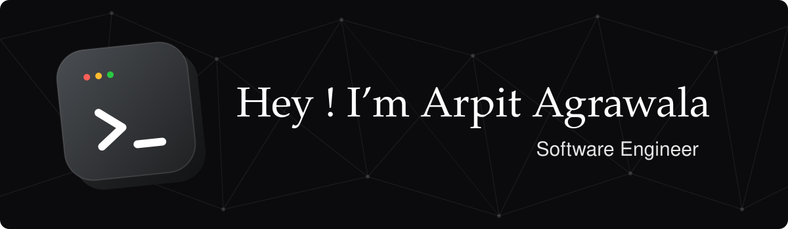

---

## 👋 About Me

- 💻 **Software engineer** who builds end to end: backend services, cloud infrastructure, CI/CD pipelines, polished frontends, **Web3 applications and smart contracts**
- 🏗️ **Server-side & infrastructure:** I design and run **scalable hosting environments**, containerised services, cloud deployments and automated delivery pipelines
- 🧠 **AI / LLM applications:** I build agent and LLM-powered apps with **LangChain** (chains, tools, retrieval, agents)
- ⛓️ **Web3:** one area among several, with experience in Solidity, Solana programs and EVM infra
- 🔭 **Currently working on:** [**Cracker.fun**](https://cracker.fun) and [**Cropr Finance**](https://app.cropr.finance), see the [spotlight below](#-currently-building) 👇
- 🤖 **AI-native workflow:** I use AI agents daily to boost productivity and ship fast, using AI efficiently to bring out the best quality in the product while keeping speed high
- ☁️ Comfortable on **GCP**, containerising with **Docker** and automating delivery with **CI/CD**
- 📍 Gurugram, India

---

## 🛠️ Tech Stack

### Web3 & Smart Contracts

### Languages

### Frontend

### AI / LLM

### Backend & Server-side

### Databases

### Cloud & DevOps

### AI-Assisted Development

### Tools

---

## 🔥 Currently Building

### &nbsp; [Cropr Finance](https://app.cropr.finance)

> **The Digital Asset Copilot.** Portfolio intelligence, risk analysis and controlled execution for professional investors and institutions across digital asset markets, without giving up custody.

**My role: Full-stack Blockchain Developer**

- 📊 Building the digital asset portfolio and execution platform used by institutions and professional operators
- 🔐 Non-custodial by design: from fragmented positions to informed decisions and controlled execution

🔗 **[Open app.cropr.finance →](https://app.cropr.finance)** · [Website](https://cropr.finance)

 

### &nbsp; [Cracker.fun](https://cracker.fun)

> **Launch a token, earn forever.** A token-launch platform where creators launch tokens and keep earning from them over time.

**My role: Full-stack Blockchain Developer**

- ⛓️ Worked on the **core smart contracts**, with its own **pump.fun-style** token launch mechanics
- ⚙️ Built the **entire CI/CD pipeline**, from commit to automated build, test and deploy
- ☁️ Hosted the **backend on Google Cloud Run**, containerised with Docker
- 📈 Designed a **robust, scalable system** that handles traffic growth and stays reliable under load
- 🖥️ Worked across the stack: frontend, backend services and infrastructure

🔗 **[Visit cracker.fun →](https://cracker.fun)**

---

## 🚀 Featured Projects

| Project | What it does | Stack |
|---|---|---|
| [**Prism-Transport**](https://github.com/Arpit098/Prism-Transport) ⭐ | Method-aware EVM RPC transport for **viem** with automatic failover, circuit breaking and smart routing across public, HyperSync and paid RPC tiers — maximises uptime, minimises cost |   |
| [**Solana-TokenSale-Management**](https://github.com/Arpit098/Solana-TokenSale-Management) | Token sale dApp (deposit, withdraw, edit price, close sale) plus a vesting dApp with claim / auto-claim |   |
| [**Cross_Bridge_Nft_MarketPlace**](https://github.com/Arpit098/Cross_Bridge_Nft_MarketPlace_On_Ethereum) | NFT marketplace across Ethereum, Polygon & Torus with cross-chain NFT migration |   |
| [**Solana-Nft-MarketPlace**](https://github.com/Arpit098/Solana-Nft-MarketPlace) | Complete NFT marketplace on Solana |   |

---

## 📊 GitHub Stats

---

## 🤝 Let's Connect

